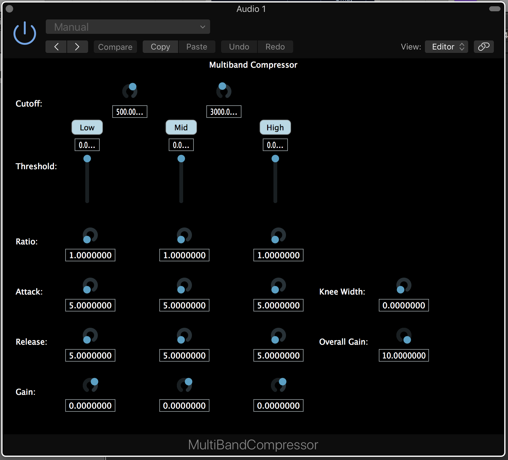

# MultiBandCompressor
A three-band dynamic range compressor audio plugin, built with JUCE. Each band has its own threshold, ratio, attack, release and gain, with adjustable crossover frequencies.

Written during my MSc in Sound and Music Computing at Queen Mary University of London (2017 to 2018).

## Running Instructions
The plugin can be compiled by running the MultiBandCompressor.jucer file.
